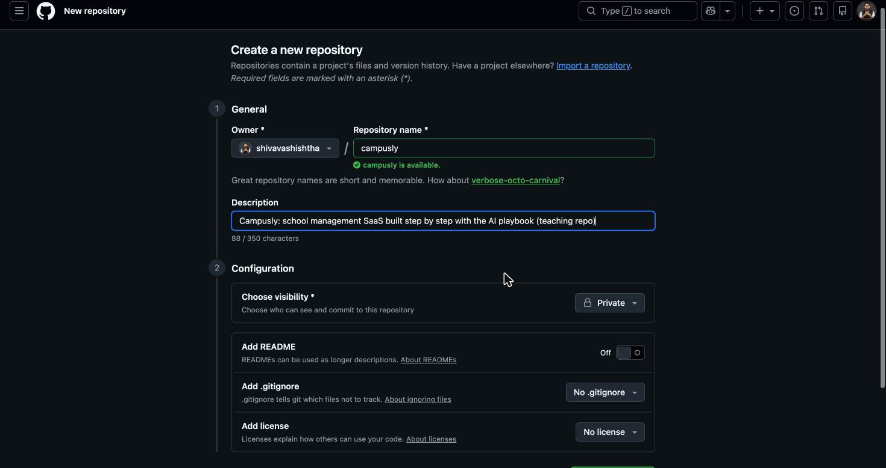
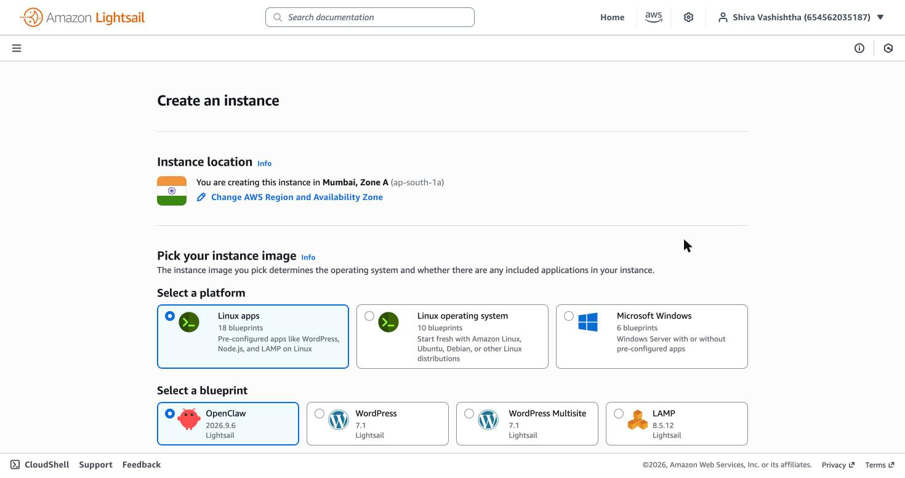
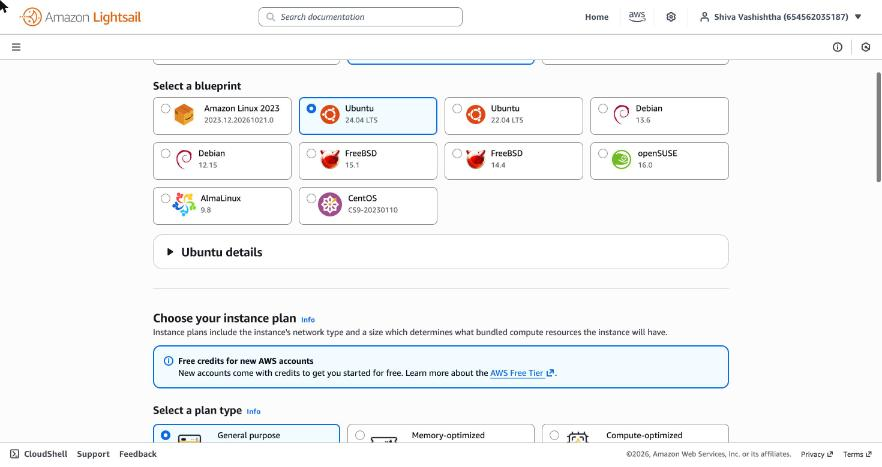
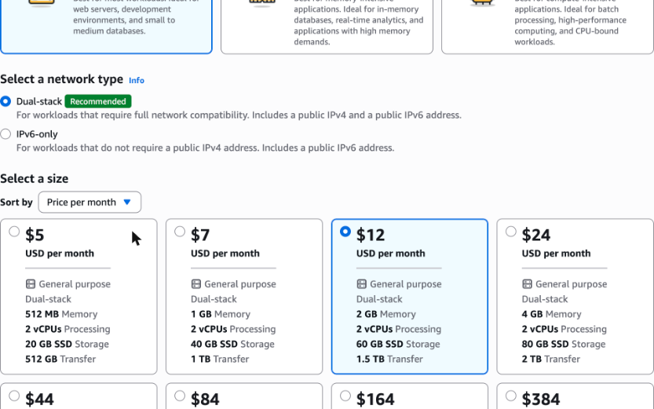
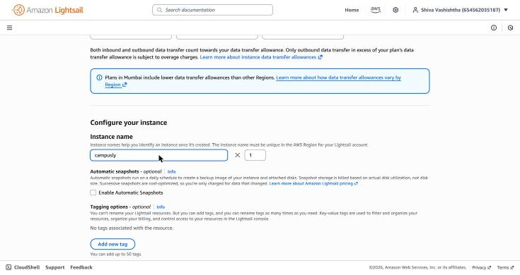
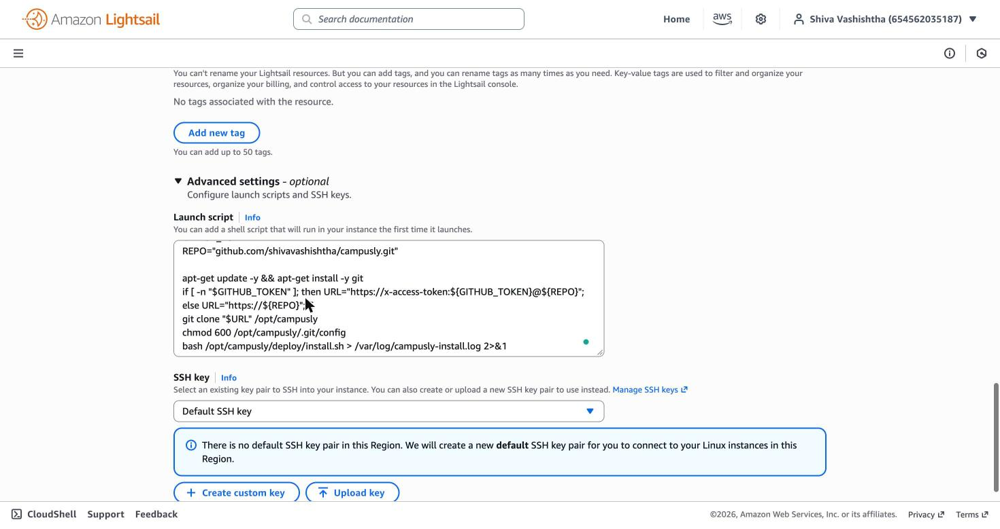
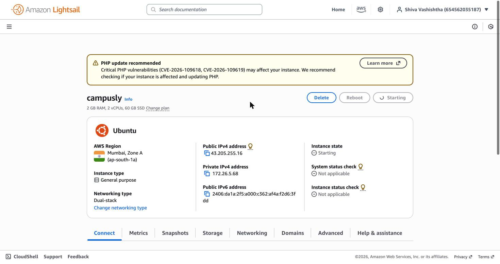
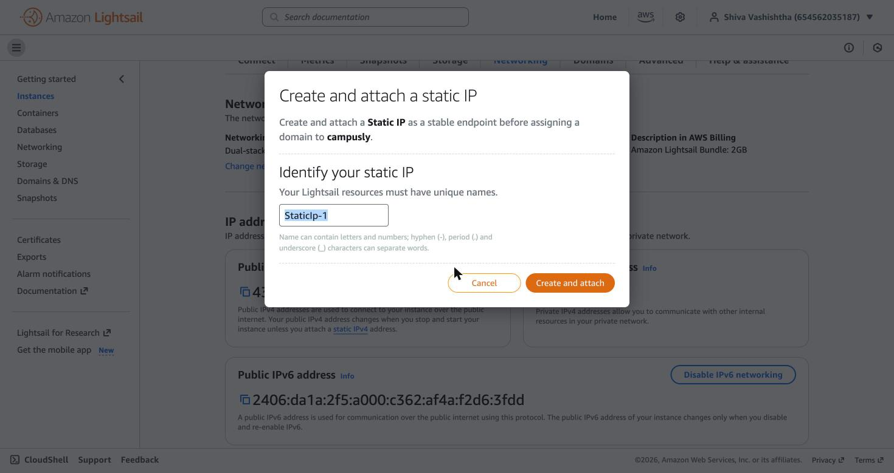
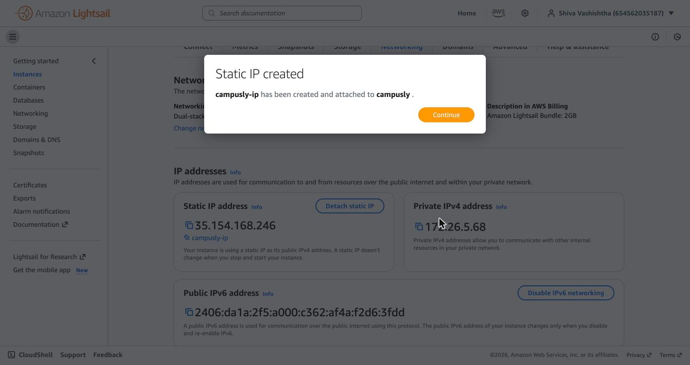
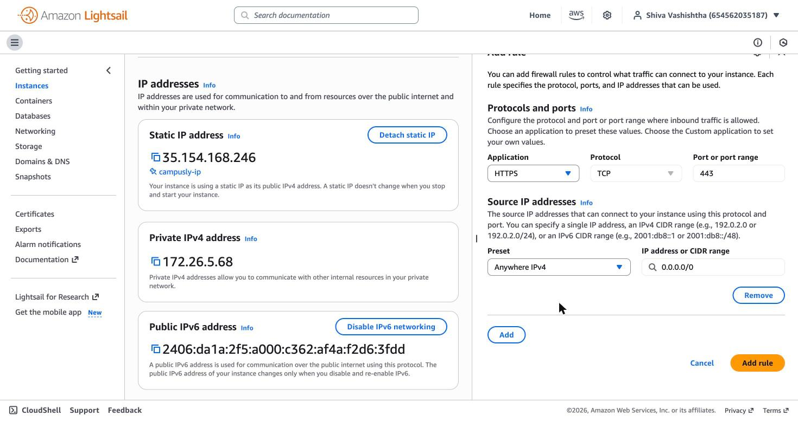

# Deploying Campusly on AWS Lightsail: step by step

> **For students.** This is exactly how Campusly was put on the internet, with a screenshot of every screen.
> Claude did most of the clicking through the **Claude in Chrome** extension; the instructor did only the parts
> marked **👤 YOU**, because an AI agent must never create accounts, enter card details, type passwords, or handle
> secret keys (PLAYBOOK §2.1, §2.4).
>
> **Result:** the live demo at **https://campusly.35-154-168-246.sslip.io**
> **Time:** about 45 minutes the first time (≈15 of them waiting). **Cost:** about $12/month, paid from AWS's free
> sign-up credit.

## What we're building

```
Students' browsers ──HTTPS──▶ Caddy (gets the HTTPS certificate by itself)
                                 │
                                 ▼
                         Campusly app (Next.js)  ──▶  database files on the server's disk
                         all on ONE Lightsail server in Mumbai, with a fixed IP address
```

One small server, everything on it: the playbook's "start on one box" rule (§9.2). The free web address
`campusly.<ip-with-dashes>.sslip.io` points at our IP automatically, so we don't need to buy a domain.

## Decisions taken before clicking anything

| Decision | Choice | Why |
|---|---|---|
| Where to host | **AWS Lightsail**, $12/month plan (2 GB memory) | Simplest AWS screens; fixed price; the app's build needs 2 GB |
| Region | **Mumbai (ap-south-1)** | Closest to the students |
| Web address | **Free sslip.io address** with automatic HTTPS | No domain to buy, no DNS to set up |
| Sign-up on the live site | **Closed; demo accounts only** (`DEMO_MODE=1`) | There's no email service yet to verify new accounts (D-010, D-015) |
| Code access | **Private GitHub repo + read-only token** | The founder chose a private repo |

Recorded as D-015 and D-016 in `docs/DECISIONS.md`.

---

## Step 1 · Create the AWS account (👤 YOU, about 15 minutes)


The sign-up page shows the offer: **USD $100 in credits, plus up to $100 more for completing activities, free for
up to 6 months.**

1. Enter your email and an account name → **Verify email address** → type the code from your inbox.
2. Create a strong password (keep it in a password manager; never share it, including with an AI).
3. Choose the **Free plan**.
4. Contact details, then a **credit/debit card** (AWS may place a ~$1 temporary hold), then **phone verification**.
5. Support plan: **Basic (free)**.

> 🤖 *Claude opened this page but did not fill it in. Account creation, cards and passwords are always the human's job.*

When you're signed in, the console home shows your region at the top right. We use **Asia Pacific (Mumbai)**:


## Step 2 · Set a budget alarm first (🤖 Claude, 👤 you type your email)

Before creating anything that costs money, set an alarm. **Billing and Cost Management → Budgets → Create budget**:

- Template: **Monthly cost budget** (not "Zero spend": that would email you the minute the server starts).
- Name: `Campusly monthly budget` · Amount: **$25**. This template ignores credits, so it tracks real usage;
  the server alone is about $12, so $25 only alerts if something unexpected starts spending.
- 👤 Type **your email** in *Email recipients* → **Create budget**. Then confirm AWS's verification email.


## Step 3 · Put the code on GitHub (🤖 Claude)

1. **github.com/new** → name `campusly`, a description, visibility **Private**, no README (the project has one).

   

2. Claude pushed the code from the computer with `git push` over SSH. Your computer's existing GitHub SSH key did
   the authentication, so no password was needed. All the commits arrived, so the stage-by-stage history is there.

   
   

## Step 4 · A read-only key so the server can download private code (🤖 Claude fills, 👤 YOU generate)

A private repo can't be downloaded without permission. We give the server the **smallest possible** permission:

**GitHub → Settings → Developer settings → Fine-grained tokens → Generate new token**
- Name `campusly-server-read`, expiry **90 days**
- Repository access: **Only select repositories → campusly**
- Permissions: **Contents: Read-only** (Metadata read-only is added automatically)


👤 GitHub first asks for **your password** ("sudo mode"); then **you** click **Generate token** and copy it. It's
shown only once. Don't paste it into chat, a document, or a commit.

> 🤖 *Why the human generates it:* a token is a secret. The agent sets up the form but never sees or types the secret.

## Step 5 · Create the server (🤖 Claude fills, 👤 YOU paste the token and click Create)

**Lightsail → Create instance:**

1. Location: **Mumbai, Zone A**

   

2. Platform **Linux/Unix → Linux operating system**, blueprint **Ubuntu 24.04 LTS**

   

3. Plan: **$12/month: 2 GB memory, 2 vCPUs, 60 GB disk.** Network type: Dual-stack (we need an IPv4 address).

   

   > ⚠️ *Real mistake from this build:* the page shifted while Claude clicked, and the **$164** plan got selected.
   > Claude spotted it in the next screenshot and fixed it before anything was created. **Always re-check the plan
   > right before you click Create.**

4. Name: **campusly**

   

5. **Advanced settings → Add launch script.** Paste the script from
   [`deploy/lightsail-launch.sh`](../deploy/lightsail-launch.sh). 👤 Put your token between the quotes on the
   `GITHUB_TOKEN=""` line.

   

6. 👤 **Create instance.** This is the step that starts billing (from your credit).

> ⚠️ *Real hiccup from this build:* the first Create click didn't produce a server (it was clicked in a different
> browser window). The instance list was empty, so nothing was charged; we refilled the form and created it again.
> **Check the instance list after clicking Create.**



The yellow "PHP update recommended" banner is a generic AWS notice; Campusly doesn't use PHP.

## Step 6 · Fixed IP address (🤖 Claude)

A server's public IP changes if it's stopped and started, and our web address is built from the IP. So: instance →
**Networking → Attach static IP** → name `campusly-ip` → **Create and attach**. A Lightsail static IP is free while
it's attached to a server.




Our address becomes **https://campusly.35-154-168-246.sslip.io**: the IP with dots turned into dashes.

## Step 7 · Open the HTTPS port (🤖 Claude)

Lightsail starts with only **SSH (22)** and **HTTP (80)** open. Websites need **HTTPS (443)**:
**Networking → Firewall → Add rule → Application HTTPS (TCP 443) → Preset Anywhere IPv4 → Add rule.**



## Step 8 · Wait while the server sets itself up (about 10 minutes)

The launch script runs once on first boot and calls [`deploy/install.sh`](../deploy/install.sh), which:

1. adds 2 GB of swap memory (the build needs it);
2. installs **Node.js 22** and **Caddy** (Caddy fetches and renews the HTTPS certificate automatically);
3. creates an app user and generates a random session secret **on the server** (it never leaves it);
4. works out the web address from the server's IP ([`deploy/configure.sh`](../deploy/configure.sh), every boot);
5. installs the app, **seeds the demo schools**, builds it, and starts it as a service that restarts by itself.

The log is on the server at `/var/log/campusly-install.log`; it ends with `CAMPUSLY READY`.

> ⏳ **Status (24 Oct 2026):** server created and healthy; the site was not answering yet ~20 minutes after creation. Diagnosis pending: see docs/NOTES.md.

---

## Redeploying after you change the code (same server, same address, no extra cost)

1. Push your changes to GitHub (`main`).
2. Lightsail → instance → **Connect using SSH** (a terminal opens in the browser).
3. Type: `sudo campusly-update`

It pulls the latest code, rebuilds and restarts in about 2–3 minutes. The data is kept; new database tables are
added automatically.

**Reset the demo data** (e.g. before a class, or after visitors have edited it): `sudo campusly-reset-demo`

## Costs, and switching off

| While running | ≈ $12/month (plan includes the IPv4 address and 1.5 TB of traffic) |
|---|---|
| Static IP while attached | free |
| Stopped | you still pay for the server's disk; **delete** the instance (and release the static IP) to stop all charges |

The **token expires in 90 days**. After that `campusly-update` can't pull until you make a new token and put it on
the server (ask Claude for the exact steps).

## What the agent did vs. what the human did

| 🤖 Claude (via Chrome extension and terminal) | 👤 Instructor |
|---|---|
| Opened every page, filled every form, picked region/plan/OS | Created the AWS account (email, password, card, phone) |
| Budget alarm settings | Typed their email for budget alerts |
| Created the GitHub repo, pushed the code | Confirmed their GitHub password |
| Token form (one repo, read-only, 90 days) | Generated and copied the token |
| Lightsail form, launch script, static IP, firewall | Pasted the token, clicked **Create instance** (billing) |
| Wrote and tested the setup scripts locally first | |
| Checked the live site | |
