# Deploying Campusly on AWS EC2: step by step

> **For students.** This is exactly how Campusly was put on the internet, with a screenshot of every important screen.
> Claude did most of the clicking through the **Claude in Chrome** extension; the instructor did only the parts
> marked **👤 YOU**, because an AI agent must never create accounts, enter card details, type passwords, or handle
> secret keys (PLAYBOOK §2.1, §2.4).
>
> **Result:** the live demo at **https://campusly.13-127-195-244.sslip.io**
> **Code:** the public repository **https://github.com/shivavashishtha/campusly**
> **Time:** about 45 minutes the first time (≈15 of them waiting). **Cost:** about $20/month, paid from AWS's free
> sign-up credit.

## What we're building

```
Students' browsers ──HTTPS──▶ Caddy (gets the HTTPS certificate by itself)
                                 │
                                 ▼
                         Campusly app (Next.js)  ──▶  database files on the server's disk
                         all on ONE EC2 server in Mumbai, with a fixed (Elastic) IP address
```

One small server, everything on it: the playbook's "start on one box" rule (§9.2). The free web address
`campusly.<ip-with-dashes>.sslip.io` points at our IP automatically, so we don't need to buy a domain.

## Decisions taken before clicking anything

| Decision | Choice | Why |
|---|---|---|
| Where to host | **AWS EC2**, one **t3.small** (2 vCPU, 2 GiB memory) | The service you'll meet at work; the app's build needs 2 GB |
| Operating system | **Ubuntu Server 24.04 LTS** | Long-term support; our setup script is tested on it |
| Region | **Mumbai (ap-south-1)** | Closest to the students |
| Web address | **Free sslip.io address** with automatic HTTPS | No domain to buy, no DNS to set up |
| Sign-up on the live site | **Closed; demo accounts only** (`DEMO_MODE=1`) | There's no email service yet to verify new accounts (D-010, D-015) |
| Code access | **Public GitHub repo** | Students use it without invitations; the server needs no token (D-018) |

Recorded as D-015, D-017 and D-018 in `docs/DECISIONS.md`. (D-016, Lightsail, was the first attempt; see "What
went wrong" at the end.)

---

## Step 1 · Create the AWS account (👤 YOU, about 15 minutes)

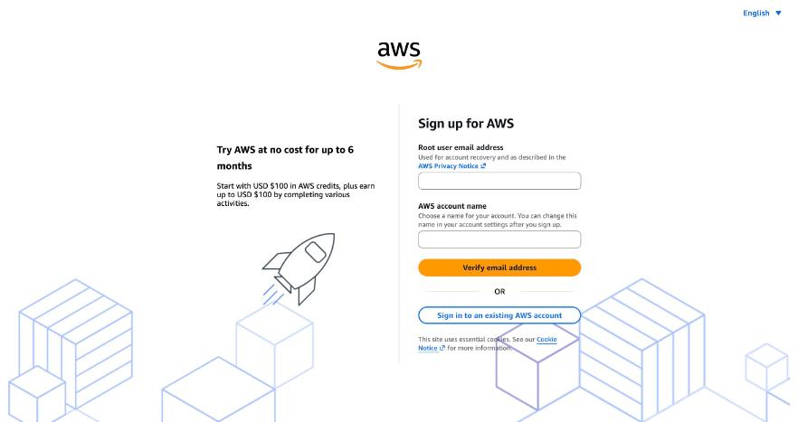

The sign-up page shows the offer: **USD $100 in credits, plus up to $100 more for completing activities, free for
up to 6 months.**

1. Enter your email and an account name → **Verify email address** → type the code from your inbox.
2. Create a strong password (keep it in a password manager; never share it, including with an AI).
3. Choose the **Free plan**.
4. Contact details, then a **credit/debit card** (AWS may place a ~$1 temporary hold), then **phone verification**.
5. Support plan: **Basic (free)**.

> 🤖 *Claude opened this page but did not fill it in. Account creation, cards and passwords are always the human's job.*

When you're signed in, the console home shows your region at the top right. We use **Asia Pacific (Mumbai)**:

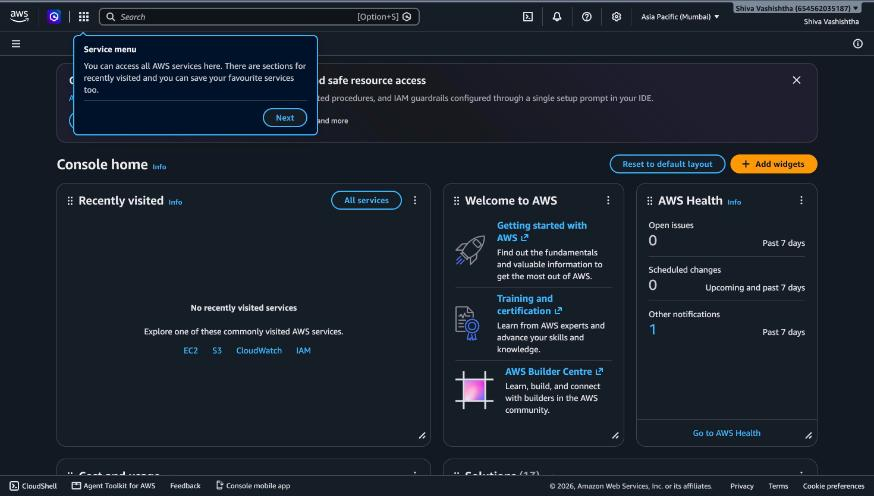

## Step 2 · Set a budget alarm first (🤖 Claude, 👤 you type your email)

Before creating anything that costs money, set an alarm. **Billing and Cost Management → Budgets → Create budget**:

- Template: **Monthly cost budget** (not "Zero spend": that would email you the minute the server starts).
- Name: `Campusly monthly budget` · Amount: **$25**. This template ignores credits, so it tracks real usage.
- 👤 Type **your email** in *Email recipients* → **Create budget**. Then confirm AWS's verification email.

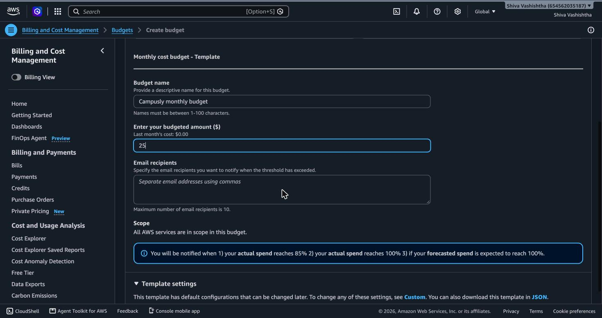
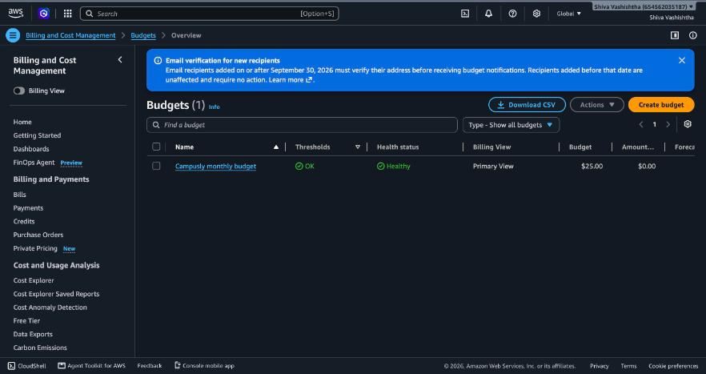

## Step 3 · Put the code on GitHub (🤖 Claude)

1. **github.com/new** → name `campusly`, a description, no README (the project has one).
2. Claude pushed the code from the computer with `git push` over SSH (your computer's existing GitHub SSH key did
   the authentication). All the commits arrived, so the stage-by-stage history is there.

   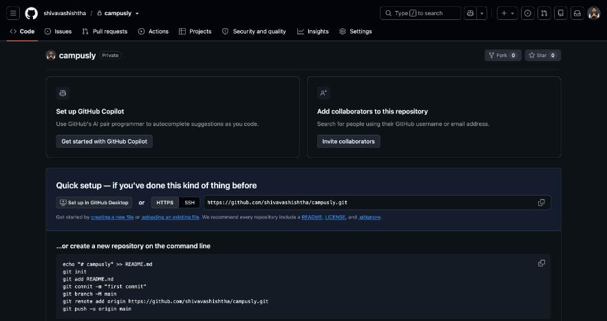
   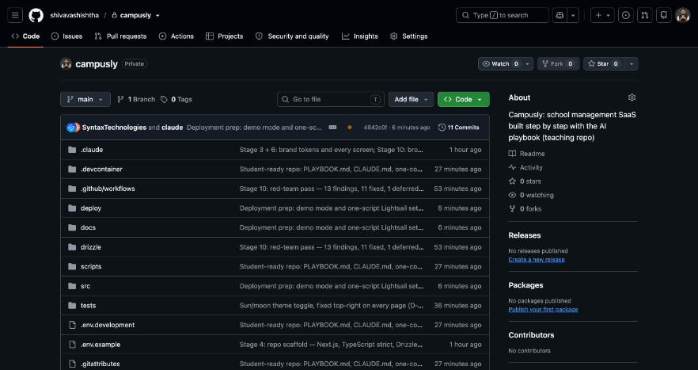

3. **Visibility: Public.** It was created private, then switched in **Settings → Danger Zone → Change visibility**
   after scanning the whole history for secrets (there were none: demo data only, and the server generates its own
   secret). A public repo lets the server download the code with no password, and lets students fork it.

   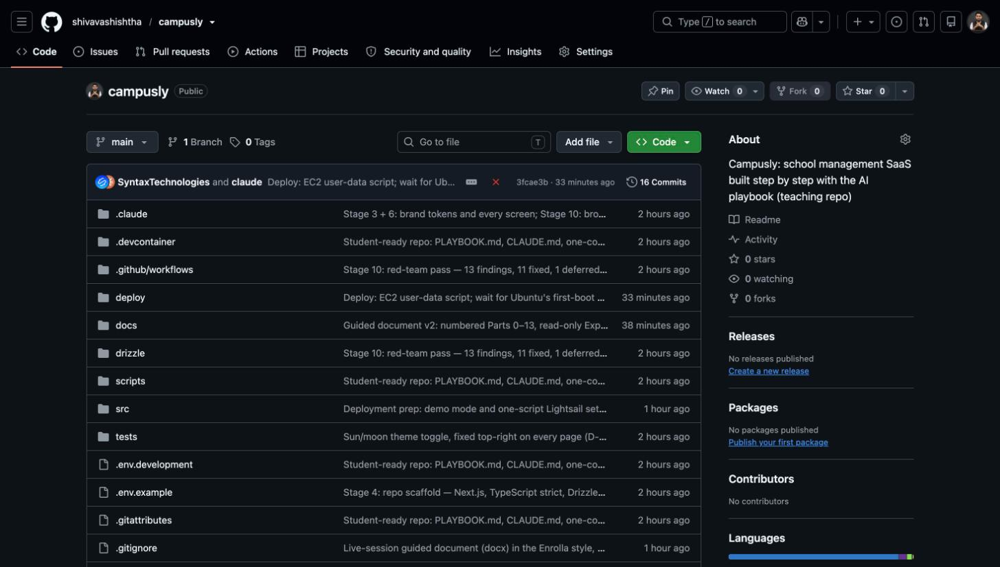

> ⚠️ **Before you make any repo public, check it has never contained a password, key or token, in any commit.**
> Deleting a file later does not remove it from the history.

## Step 4 · Create a read-only GitHub token (only if your repo is private) (🤖 Claude fills, 👤 YOU generate)

Campusly's repo is public, so its server skips this step. **If your own copy is private, the server cannot download
it without permission**, and this is the most important step to get right: on our first attempt the token box was
left empty, `git clone` failed with *could not read Username for 'https://github.com'*, and the site never came up.

Give the server the **smallest possible** permission:

1. GitHub → your photo (top right) → **Settings** → **Developer settings** (bottom of the left menu) →
   **Personal access tokens → Fine-grained tokens** → **Generate new token**.
2. Token name `campusly-server-read`; Expiration **90 days**.
3. Repository access: **Only select repositories** → pick **campusly**.
4. Permissions → Repository permissions → **Contents: Read-only** (Metadata: Read-only is added automatically).
   Nothing else.
5. 👤 GitHub asks for **your password** ("sudo mode"); then **you** click **Generate token** and copy it. It's shown
   only once.

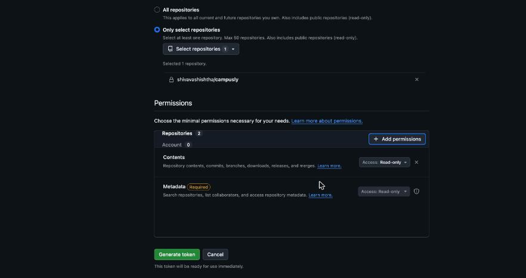

> 🔒 **Where the token may go:** only into the `GITHUB_TOKEN=""` line of the user data in Step 5, or into a
> terminal prompt that hides what you type. **Never** into a chat (including with Claude), a document, a screenshot
> or a commit. A token typed into a chat is a leaked token: delete it on GitHub and make a new one.
> Not a "classic" token (`ghp_…`): those can read **every** repo you own.

> 🤖 *Why the human generates it:* a token is a secret. The agent sets up the form but never sees or types the secret.

## Step 5 · Launch the server (🤖 Claude fills, 👤 YOU click Launch)

**EC2 → Instances → Launch instances**, then top to bottom:

1. **Name:** `campusly`.
2. **Application and OS Images:** Quick Start → **Ubuntu**, then open the AMI list and choose
   **Ubuntu Server 24.04 LTS (HVM), SSD Volume Type**. The default is 26.04; don't pick either **Ubuntu Pro** line
   (it costs extra).

   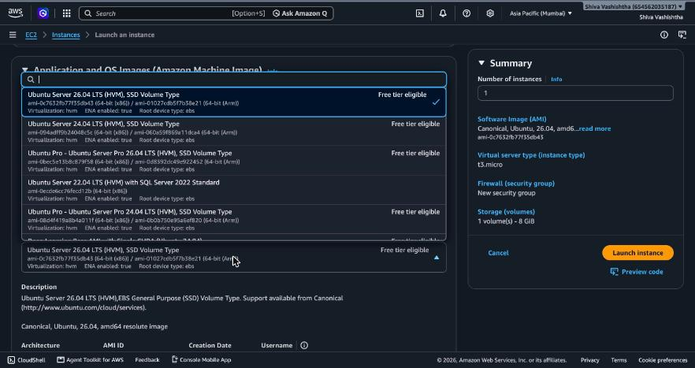

3. **Instance type:** **t3.small** (2 vCPU, 2 GiB). The default t3.micro has 1 GiB, too little for the build.
4. **Key pair:** **Proceed without a key pair**. We use the browser terminal (EC2 Instance Connect) instead, so
   there's no key file to lose.
5. **Network settings:** Create security group, tick **Allow SSH**, **Allow HTTPS** and **Allow HTTP** traffic from
   the internet. (The yellow 0.0.0.0/0 warning is expected for a public website.)

   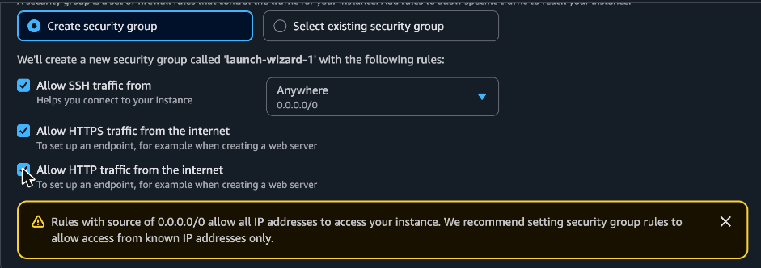

6. **Configure storage:** **20 GiB** gp3 (8 GiB is too small for Node, the build and the database).
7. **Advanced details → User data:** paste the whole of
   [`deploy/ec2-user-data.sh`](../deploy/ec2-user-data.sh). Public repo: leave `GITHUB_TOKEN=""` empty.
   Private repo: 👤 put your token from Step 4 between the quotes.

   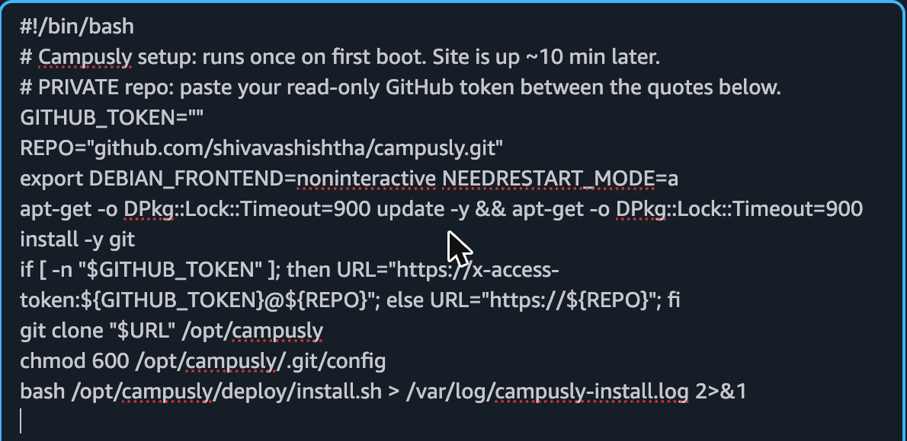

8. **Check the Summary on the right:** Ubuntu 24.04, **t3.small**, 1 volume of 20 GiB. Then 👤 **Launch instance**.
   This is the step that starts billing (from your credit).

   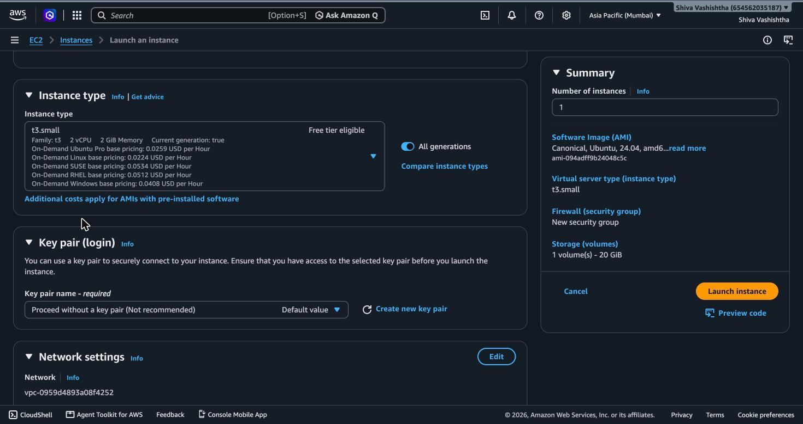
   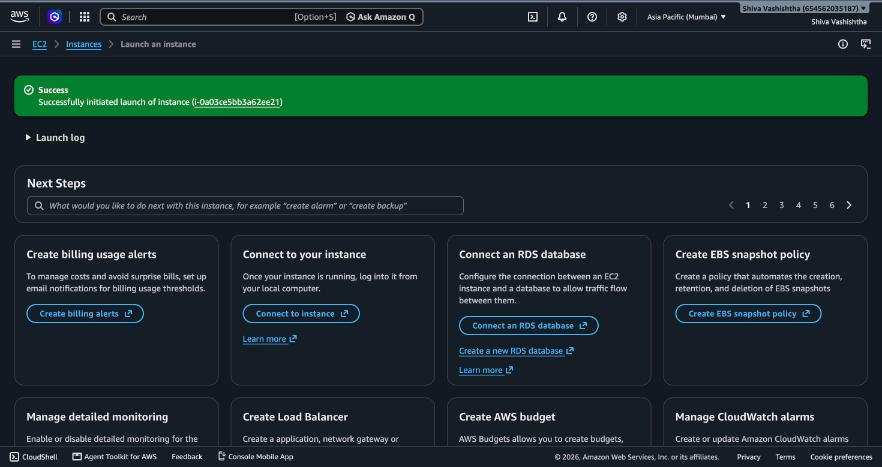

> ⚠️ *Real mistakes from this build:* the page shifted while Claude clicked, and a different instance type and
> Ubuntu Pro got selected; then a "Confirm changes" dialog appeared exactly over the wizard's **Cancel** button and
> one click threw the form away. Nothing was launched by mistake, because the Summary was re-checked every time.
> **One click, then look, then the next click. Re-read the Summary before Launch.**

## Step 6 · Fixed IP address (🤖 Claude)

A server's public IP changes if it's stopped and started, and our web address is built from the IP. So:
**EC2 → Elastic IPs → Allocate Elastic IP address → Allocate**, then **Actions → Associate Elastic IP address** →
Instance: `campusly` → **Associate**.

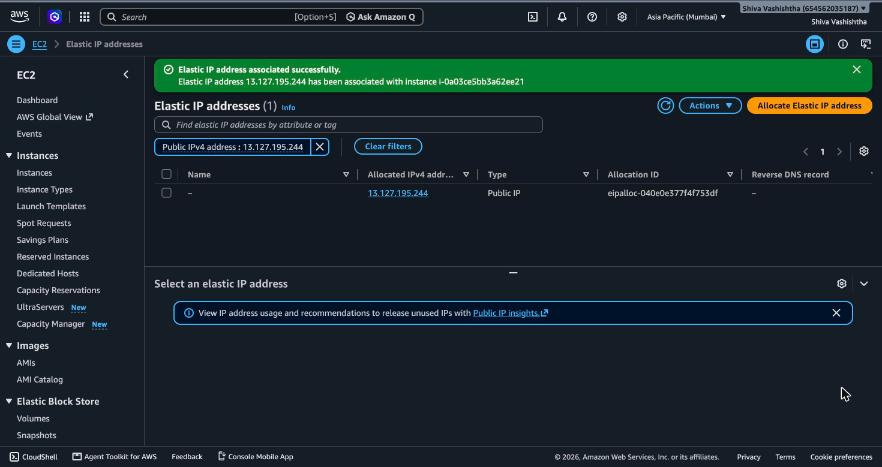

Our address becomes **https://campusly.13-127-195-244.sslip.io**: the IP with dots turned into dashes.
The address is worked out again on every boot, so attaching the Elastic IP after launch is fine.

## Step 7 · Wait while the server sets itself up (about 10 minutes)

The user data runs once on first boot: it downloads the repo and runs [`deploy/install.sh`](../deploy/install.sh),
which:

1. waits for Ubuntu's own first-boot updates to finish, then adds 2 GB of swap memory (the build needs it);
2. installs **Node.js 22** and **Caddy** (Caddy fetches and renews the HTTPS certificate automatically);
3. creates an app user and generates a random session secret **on the server** (it never leaves it);
4. works out the web address from the server's IP ([`deploy/configure.sh`](../deploy/configure.sh), every boot);
5. installs the app, **seeds the demo schools**, builds it, and starts it as a service that restarts by itself.

**To watch it:** instance → **Connect → EC2 Instance Connect → Connect** (a terminal opens in the browser), then:

```
cloud-init status
sudo tail -n 20 /var/log/campusly-install.log
```

It's done when the log ends with `CAMPUSLY READY`. Then open the address:

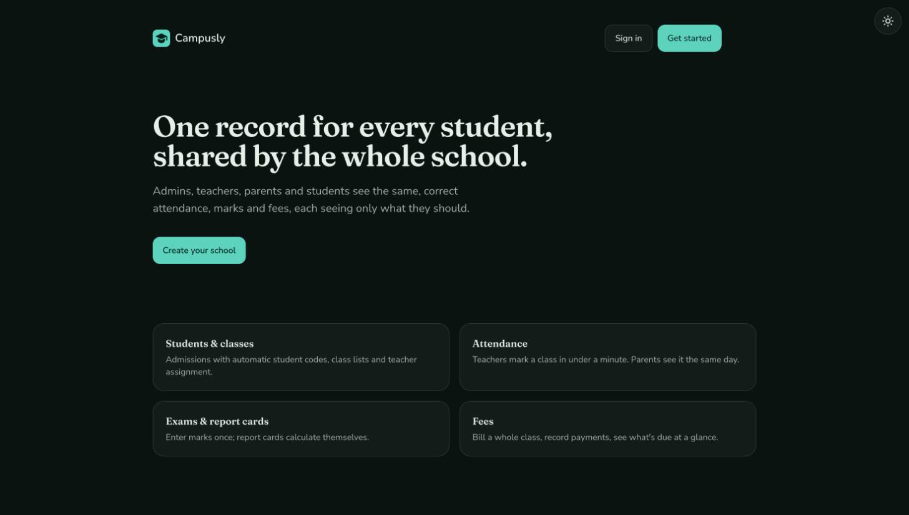

Sign in with any demo account from the README (password `campusly-demo-1`).

---

## Redeploying after you change the code (same server, same address, no extra cost)

1. Push your changes to GitHub (`main`).
2. EC2 → instance → **Connect → EC2 Instance Connect → Connect**.
3. Type: `sudo campusly-update`

It pulls the latest code, rebuilds and restarts in about 2–3 minutes. The data is kept; new database tables are
added automatically. (Private repo? The token in the server's clone expires after 90 days; make a new one and ask
Claude for the steps, typing the token only at a hidden prompt.)

**Reset the demo data** (e.g. before a class, or after visitors have edited it): `sudo campusly-reset-demo`

## Costs, and switching off

| While running | t3.small ≈ $16/month + public IPv4 ≈ $3.60/month + 20 GiB disk ≈ $1.80/month |
|---|---|
| Stopped | you still pay for the disk and the Elastic IP |
| To stop all charges | **Terminate** the instance, then **Release** the Elastic IP |

## What went wrong the first time (and why we moved to EC2)

The first server was on **Lightsail**. It started, but the site never answered. The cause, found later on EC2: the
repo was private and the launch script's token was empty, so the download failed and nothing was installed. The
founder then chose EC2 (D-017) and made the repo public (D-018). The Lightsail server and its static IP were deleted.

## What the agent did vs. what the human did

| 🤖 Claude (via Chrome extension and terminal) | 👤 Instructor |
|---|---|
| Opened every page, filled every form, picked region/OS/type/disk/firewall | Created the AWS account (email, password, card, phone) |
| Budget alarm settings | Typed their email for budget alerts |
| Created the GitHub repo, pushed the code, scanned history before going public | Confirmed their GitHub password; chose public |
| User data, Elastic IP | Clicked **Launch instance** (billing) |
| Wrote and tested the setup scripts locally first; checked the live site and a demo sign-in | |
